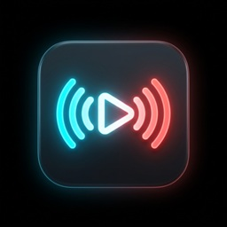

<p align="center">
  
  <br>
  <h1 align="center">SwitchCast</h1>
  <p align="center">
    <b>Receptor de mídia e streaming de alto desempenho com arquitetura modular para o Nintendo Switch</b><br>
    <i>Versão 2.3.0 &bull; Comp. 29 &bull; Desenvolvido por <b>Aleff959</b></i>
  </p>
  <p align="center">
    
    
    
    
    
    
    
  </p>
</p>

---

**SwitchCast v2.3.0 (Comp. 29)** traz uma evolução marcante no ecossistema homebrew para o **Nintendo Switch**. Desenvolvido em **C++20**, o projeto conta com uma nova **Interface Minimalista ("Vamos dar o play?")**, animação fluida de metamorfose matemática onde as **3 barras do menu hambúrguer transformam-se no console Nintendo Switch**, backdrop com desfoque óptico e **símbolos flutuantes estilo DVD Player com física de colisões elásticas 2D**, além de uma **gaveta lateral deslizante** com abas em linha única (`Como Usar`, `Novidades`, `Sobre`), servidor FTP ultrarrápido integrado e decodificação por hardware **Tegra X1 NVDEC** (`nvtegra`).

---

## ✨ Destaques da Versão 2.3.0 (Comp. 29)

- 🎮 **Botão Switch Morph (Interpolação Matemática C++ / Web)**:
  - O botão superior esquerdo não troca imagens: as 3 barras horizontais realizam interpolação geométrica contínua (`t` de `0.0` a `1.0`), tornando-se o Joy-Con L azul (`#00C3E3`), a tela OLED central (`#0B0D11`) e o Joy-Con R vermelho (`#FF3C28`) com pontos analógicos.
- 🪟 **Tela Frontal Centralizada & Minimalista ("Vamos dar o play?")**:
  - Painel frontal limpo, livre de poluição visual, destacando o botão central de Play com pulso suave, tipografia nítida e indicação intuitiva de transmissão.
- 📀 **Símbolos Flutuantes Estilo DVD Player com Física 2D**:
  - 4 símbolos táteis (△, ○, □, ✕) flutuando no plano de fundo com reflexão elástica nas bordas, colisão elástica bidimensional entre si, amortecimento de escala dinâmica (`scale = 1.25`) e alternância de cores a cada impacto.
- 📂 **Gaveta Lateral Deslizante & Abas em Linha Única**:
  - Gaveta suave de 420px com botão touch `✕`, cards organizados e abas sem quebra de texto: `Como Usar`, `Novidades` e `Sobre` (com identificação nativa `Atmosphère CFW`).
- 📁 **Servidor FTP de Alta Performance Integrado (Portas 5000 / 21)**:
  - Acesso direto e veloz aos arquivos do cartão microSD.
- 🚀 **Arquitetura Modular em 2 Estágios (Launcher + Core)**:
  - **`SwitchCast.nro` (Launcher / App Pai - ~7.4 MB)**: Ponto de entrada oficial com inicialização rápida (~2ms).
  - **`SwitchCastCore.nro` (Módulo Core - ~30 MB)**: Motor multimídia completo com aceleração Tegra NVDEC e renderizador OpenGL 4.3 Core Profile.
- 🔄 **Atualizações OTA Zero-Lock (Livres de Bloqueio FAT32)**:
  - O Horizon OS mantém arquivos `.nro` em execução travados pelo driver do sistema de arquivos. No SwitchCast v2.0.0, as atualizações são baixadas em segundo plano pelo Core e instaladas de forma atômica pelo Launcher, que assume o display com uma barra de progresso visual, substitui os binários, realiza o flush seguro no microSD (`fsdevCommitDevice`) e recarrega o app sem exigir reinicialização do console.
- 🛡️ **Proteção Anti-Brick BootGuard**:
  - Mecanismo de integridade com backup automático (`SwitchCastCore.nro.bak`) e detecção de falhas. Se uma versão corrompida for instalada ou se o usuário segurar o botão de cancelamento, o Launcher restaura a versão funcional imediatamente.
- 🎨 **Renderizador 2D Nativo OpenGL 4.3 com Shaders GLSL**:
  - Motor gráfico desacoplado com retângulos de cantos arredondados procedimentais, anti-aliasing via pixel shader, sombras gaussianas dinâmicas e tipografia FreeType 2 calibrada com extração de fontes de sistema direto da memória RAM (`plGetSharedFontByType`).
- 📺 **Design Otimizado para Telas OLED & Dynamic Refresh**:
  - Fundo com preto absoluto (`#000000`) para desligamento físico dos subpixels OLED, economizando bateria e protegendo o painel.
  - Taxa de quadros dinâmica: opera a 15 FPS em repouso no Dashboard e sincroniza a 60 FPS automáticos durante a reprodução de vídeo.
- ⚡ **Aceleração por Hardware Tegra X1 (`nvtegra`)**:
  - Decodificação suave de streams H.264 e HEVC/H.265 (inclusive 10-bit) a 60 FPS via `libmpv` e pipeline de áudio nativo Horizon (`ao=hos` / `audren`).
- 📱 **Central Web de Controle Remoto (`http://<ip-do-switch>:5000`)**:
  - Acesse pelo celular ou computador para controlar reprodução, volume, busca (seek), envio direto de links `.mp4`, `.mkv`, `.m3u8` (HLS) e acompanhamento de status do console.
- 📡 **Compatibilidade Universal UPnP / DLNA**:
  - Totalmente compatível com **BubbleUPnP**, **Web Video Caster**, **VLC Media Player**, **TV Assist** e comandos via API REST / WebSocket.

---

## 1. Arquitetura Modular e Fluxo de Execução

```
                    ┌───────────────────────────────────────────────┐
                    │          Homebrew Menu (Atmosphère)           │
                    └───────────────────────┬───────────────────────┘
                                            │ Executa
                                            ▼
                    ┌───────────────────────────────────────────────┐
                    │          SwitchCast.nro (Launcher)            │
                    │         sdmc:/switch/SwitchCast/              │
                    └───────┬───────────────────────────────┬───────┘
                            │                               │
        [Se houver update pendente]            [Inicialização normal (dia a dia)]
                            │                               │ (~2ms)
                            ▼                               ▼
      ┌─────────────────────────────────┐       ┌───────────────────────┐
      │     Interface EGL / OpenGL      │       │     envSetNextLoad    │
      │   - Barra de progresso visual   │       └───────────┬───────────┘
      │   - Substituição livre de travas│                   │
      │   - Flush SD (fsdevCommitDevice)│                   ▼
      │   - Rollback automático de erro │       ┌───────────────────────┐
      └─────────────────┬───────────────┘       │   SwitchCastCore.nro  │
                        │                       │  (Módulo Principal)   │
                        └──────────────────────>│   sdmc:.../modules/   │
                                                └───────────────────────┘
```

### Por que a Arquitetura em Dois Estágios?
No Horizon OS, qualquer binário aberto pelo Homebrew Menu permanece com descritores de arquivo abertos em nível de driver no FAT32. Tentar sobrescrever o próprio `.nro` em execução gera falhas de escrita ou corrupção de sistema de arquivos. 

A arquitetura **Two-Stage** do SwitchCast v2.0.0 resolve isso de forma elegante:
1. O executável principal que o sistema executa no dia a dia é o **Core** (`modules/SwitchCastCore.nro`).
2. Quando uma nova versão é recebida (via OTA na internet ou push local via script), o arquivo é salvo em um arquivo temporário (`modules/update.nro`).
3. O Core se despede e transfere o controle de volta ao **Launcher** (`SwitchCast.nro`).
4. Como o Core **não** está mais em execução, seus arquivos estão completamente destravados.
5. O Launcher substitui o binário, faz backup da versão anterior, chama `fsdevCommitDevice("sdmc")` para garantir a persistência física no cartão SD e inicia o novo Core imediatamente.

---

## 2. Decisões de Engenharia e Tecnologias

1. **Aceleração de Hardware Tegra X1 (`nvtegra`)**:
   - Integração direta com a GPU do Tegra X1 através de decodificadores dedicados do chip, garantindo baixo aquecimento, baixo consumo de energia e reprodução sem perda de quadros.
2. **Horizon Native Audio (`ao=hos`)**:
   - Saída de som gerenciada pelo Horizon Audio Renderer (`audren`), permitindo saída estéreo limpa sem atrasos ou distorções.
3. **Métricas de Fonte e Tipografia FreeType 2**:
   - O motor de renderização `Renderer2D` calcula dinamicamente o avanço horizontal (`advance`) de cada glifo, garantindo suporte completo a caracteres UTF-8, acentuação e alinhamento tipográfico perfeito sem sobreposição de textos.
4. **Layout Responsivo Adaptativo**:
   - O dashboard e os menus detectam em tempo real o modo do console:
     - **Handheld (720p)**: 1280x720, elementos dimensionados com espaçamentos otimizados para leitura em tela de 7 polegadas.
     - **Docked (1080p)**: 1920x1080, redimensionamento automático de cards e fontes com escala nítida.

---

## 3. Protocolos de Rede e API

O SwitchCast v2.0.0 opera com servidores leves embarcados baseados no CivetWeb:

### 3.1. UPnP / DLNA (MediaRenderer:1)
- **SSDP**: Responde ativamente a buscas `M-SEARCH` (`ssdp:all`, `upnp:rootdevice`, `urn:schemas-upnp-org:device:MediaRenderer:1`) e emite anúncios periódicos de presença na rede.
- **Serviços Suportados**: `AVTransport:1`, `RenderingControl:1` e `ConnectionManager:1`.
- Compatível nativamente com transmissões de celulares (Android/iOS) e PCs via BubbleUPnP, VLC e navegadores.

### 3.2. Central Web Remote (`http://<ip-do-switch>:5000`)
Interface web responsiva com identidade visual moderna, permitindo:
- Play, Pause, Stop, Seek interativo e controle de volume (0 a 100%).
- Envio instantâneo de links diretos de mídia.
- Seleção de faixas de áudio e legendas embutidas ou externas.
- Telemetria de bateria, temperatura e status de conexão.

### 3.3. REST API (`/api/v1`)

| Método | Endpoint | Descrição |
|---|---|---|
| `GET` | `/api/v1/info` | Retorna metadados do console (UUID, IP, versão, portas). |
| `GET` | `/api/v1/status` | Retorna estado de reprodução, posição, duração, volume e metadados da mídia. |
| `POST` | `/api/v1/play` | Inicia ou retoma a reprodução (aceita JSON com `url`, `title`, `headers`, `subtitles`). |
| `POST` | `/api/v1/pause` | Pausa a mídia atual. |
| `POST` | `/api/v1/stop` | Interrompe a reprodução e retorna ao Dashboard OLED. |
| `POST` | `/api/v1/seek` | Ajusta posição temporal (`{"positionMs": 30000}`). |
| `POST` | `/api/v1/volume` | Ajusta o nível de áudio (`{"level": 75}`). |
| `POST` | `/api/v1/system/ota-update` | Endpoint para push de atualização remota sem fio via LAN. |
| `POST` | `/api/v1/system/rollback` | Reverte imediatamente para a versão funcional anterior (`.bak`). |

---

## 4. Mapeamento de Controles e Gestos Touch

```
[ZL / L]                                                               [ZR / R]
Volume -                                                               Volume +
   ▲                                                                      ▲
   │                                                                      │
┌──┴──────────────────────────────────────────────────────────────────────┴──┐
│  [D-Pad]                                                   (X) Áudio       │
│  ▲ : +60s Seek                                             (Y) Legendas    │
│  ▼ : -60s Seek                                             (A) Play/Pause  │
│  ◄ : -10s Seek                                             (B) Esconder OSD│
│  ► : +10s Seek                                                             │
│  [-] : Mudo / Desmudo                                      (+) Sair        │
│                                                                            │
│                           TELA OLED (Touch Gestures)                       │
│                   Toque Rápido: Exibe/Oculta Barra de Controle             │
│                   Deslizar Esquerda (Vertical): Ajuste de Brilho           │
│                   Deslizar Direita (Vertical): Ajuste de Volume Áudio      │
│                   Arrastar Horizontal (Centro): Seek na Linha do Tempo     │
└────────────────────────────────────────────────────────────────────────────┘
```

---

## 5. Estrutura do Repositório

```
SwitchCast/
├── Makefile                     # Build do Módulo Core (SwitchCastCore.nro)
├── SwitchCast.nro               # Binário oficial do Launcher (App Pai)
├── SwitchCastCore.nro           # Binário compilado do Módulo Core v2.0.0
├── icon.jpg                     # Ícone oficial do app em alta resolução
├── update_manifest.json         # Manifesto oficial de distribuição de updates OTA
├── launcher/
│   ├── Makefile                 # Build do Launcher (SwitchCast.nro)
│   └── main.cpp                 # Motor de inicialização rápida e instalador gráfico EGL
├── include/
│   └── updater/                 # Headers do sistema de atualização e BootGuard
│       ├── ModuleManager.hpp
│       ├── OtaFileEmunandFix.hpp
│       └── OtaUpdater.hpp
├── src/
│   ├── main.cpp                 # Entry point do Core, loop de eventos Horizon
│   ├── common/                  # Definições de tipos, comandos thread-safe
│   ├── network/                 # CivetWeb, UPnP, SSDP e Web Remote
│   ├── player/                  # Integração libmpv e aceleração Tegra NVDEC
│   ├── ui/                      # Renderer2D OpenGL 4.3, UIEngine, OledBurnInGuard
│   ├── updater/                 # Implementação do OtaUpdater e ModuleManager
│   └── utils/                   # Log, Platform, PosixStubs, manipulação de texto
├── modules/                     # Estrutura para módulos extensíveis e plugins
├── tools/
│   ├── deploy_ota.ps1           # Script PowerShell para deploy e teste remoto de OTA
│   └── upload_ftp.py            # Utilitário de envio rápido via FTP para o Switch
└── third_party/
    ├── civetweb/                # Servidor HTTP/WebSocket ultraleve em C
    └── nlohmann/json.hpp        # Manipulador de JSON moderno para C++
```

---

## 6. Instalação no Nintendo Switch

### Método Recomendado (Estrutura Modular v2.0.0)

1. Conecte o cartão microSD do Switch ao computador ou utilize um servidor FTP no console (como o *sys-ftpd-ovl*).
2. Certifique-se de criar a seguinte estrutura de pastas:
   ```
   sdmc:/
   └── switch/
       └── SwitchCast/
           ├── SwitchCast.nro              <-- Launcher (App Pai)
           └── modules/
               └── SwitchCastCore.nro      <-- Módulo Core principal
   ```
3. Abra o Homebrew Menu em modo **Title Takeover** (segure o botão `R` ao abrir qualquer jogo oficial) para garantir acesso total à memória RAM e à aceleração gráfica da GPU.
4. Selecione o **SwitchCast**! A partir de agora, qualquer atualização futura poderá ser feita **diretamente pela internet (OTA)** sem precisar remover o cartão SD.

---

## 7. Compilação a partir do Código-Fonte

### Pré-requisitos
Instale o ambiente [devkitPro](https://devkitpro.org/) com a toolchain do Nintendo Switch (`switch-dev`):
```bash
sudo dkp-pacman -S \
    switch-dev \
    switch-libnx \
    switch-mesa \
    switch-glad \
    switch-libmpv \
    switch-ffmpeg \
    switch-libass \
    switch-freetype \
    switch-mbedtls \
    switch-zlib
```

### 1. Compilar o Launcher (App Pai)
```bash
cd launcher
make -j$(nproc)
```
Gera `launcher/SwitchCast.nro`.

### 2. Compilar o Módulo Core
```bash
cd ..
make -j$(nproc)
```
Gera `SwitchCastCore.nro`.

### Compilação no Windows (PowerShell)
Você pode utilizar o script wrapper que compila fora de pastas do OneDrive para máxima velocidade:
```powershell
.\scripts\build_win.ps1
```

---

## 📄 Licença

Este projeto é distribuído sob os termos da licença **MIT**. Consulte o arquivo [LICENSE](LICENSE) para mais detalhes.

Desenvolvido por **Aleff959** &copy; 2026.
